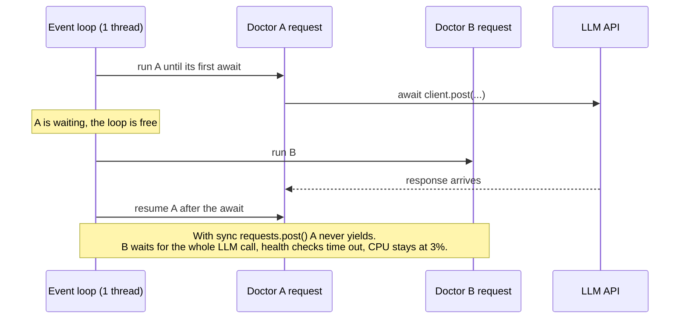

# Python & Linux Foundations

## Event loop architecture

> **Core** | ~1.2 h | Slow: step 018/256, CP1 | Fast: CP1
>
> Before this: [M01-04 Exception handling](<04 - Exception handling.md>)

### Kahani
Ek hospital customer ke liye aapne FastAPI pe ek "discharge summary" service banayi -- har request ek LLM call karti hai.
Demo mein sab smooth tha. Go-live ke din 30 doctors ek saath use karne lage aur har request 40 second le rahi thi, health check bhi timeout.
CPU 3% pe tha. Pata chala: `async def` endpoint ke andar purana sync `requests.post(...)` aur sync DB driver use ho raha tha.
Ek request jab tak LLM ka wait karti, poora server freeze -- baaki 29 doctors line mein.
Node mein aapne ye bug kabhi `fs.readFileSync` ke saath dekha hoga. Python mein ye aur aasaani se ho jaata hai.

### What it is
**Event loop** ek single-threaded scheduler hai jo ready coroutines ko ek-ek karke chalata hai aur jab koi `await` pe I/O ka wait karta hai to doosre ko chala deta hai.
Mental model JS jaisa hi hai: ek thread, ek queue, cooperative switching. Fark: Python mein loop "free" nahi milta -- `asyncio.run()` use banata hai, aur har thread ka apna (max ek) running loop hota hai.

### Why it matters for an FDE
Customer integrations mein 90% kaam I/O wait hai (LLM, CRM, DB). Ek bhi blocking call (`time.sleep`, `requests`, sync `psycopg2`, heavy JSON parse) poore service ki latency kharab kar deta hai, aur CPU graph pe kuch dikhta bhi nahi.

### Key concepts
- **Cooperative scheduling** -- switch sirf `await` pe hota hai; jo code await nahi karta wo loop ko pakad ke rakhta hai (JS jaisa).
- **One loop per thread** -- `asyncio.run()` naya loop banata hai; doosre thread mein `get_running_loop()` RuntimeError deta hai. Node mein process ka ek hi loop hota hai.
- **Callbacks queue** -- `loop.call_soon` (next iteration, roughly `queueMicrotask`/`setImmediate` jaisa) aur `loop.call_later` (`setTimeout` jaisa).
- **Blocking call = frozen loop** -- `time.sleep(1)` sab ko 1 s rokta hai; `await asyncio.sleep(1)` sirf us coroutine ko.
- **Escape hatch** -- blocking code ko `await asyncio.to_thread(fn)` ya `loop.run_in_executor(...)` se thread pool mein bhejo ([M01-10](<10 - ThreadPoolExecutor integration.md>)).

### Picture it
One thread, one loop: the server only stays responsive if every request gives the loop back at each await.



### Code example
stdlib only

```python
# runnable
import asyncio
import threading
import time


async def heartbeat(stop, gaps):
    """Ticks every 20 ms and records the real gap -- a big gap means the loop was frozen."""
    last = time.perf_counter()
    while not stop.is_set():
        await asyncio.sleep(0.02)
        now = time.perf_counter()
        gaps.append(now - last)
        last = now


async def measure(label, work):
    stop, gaps = asyncio.Event(), []
    hb = asyncio.create_task(heartbeat(stop, gaps))
    await asyncio.sleep(0.05)                 # let the heartbeat start
    await work()
    stop.set()
    await hb
    worst = max(gaps)
    print(f"{label:<28} worst heartbeat gap = {worst*1000:6.0f} ms")
    return worst


async def blocking_llm_call():
    time.sleep(0.5)                           # sync client, e.g. requests.post(...)


async def async_llm_call():
    await asyncio.sleep(0.5)                  # async client, e.g. await httpx_client.post(...)


async def offloaded_llm_call():
    await asyncio.to_thread(time.sleep, 0.5)  # sync client moved to a worker thread


async def order_demo():
    loop = asyncio.get_running_loop()
    order = []
    loop.call_later(0.01, order.append, "call_later (like setTimeout)")
    loop.call_soon(order.append, "call_soon (next loop iteration)")
    order.append("sync code runs first")
    await asyncio.sleep(0.05)
    return order


def other_thread(result):
    try:
        asyncio.get_running_loop()
    except RuntimeError:
        result.append("no running loop in this thread")


async def main():
    bad = await measure("blocking time.sleep", blocking_llm_call)
    good = await measure("await asyncio.sleep", async_llm_call)
    off = await measure("asyncio.to_thread(sleep)", offloaded_llm_call)
    assert bad > 0.45, "blocking call should freeze the loop"   # always >= 0.5: the loop cannot run during time.sleep(0.5)
    # slack on purpose: a busy laptop (antivirus, first thread start) can add ~0.1-0.3 s to any gap
    assert good < 0.4 and off < 0.4, "non-blocking calls keep the loop responsive"

    order = await order_demo()
    print(order)
    assert order[0] == "sync code runs first" and order[1].startswith("call_soon")

    result = []
    t = threading.Thread(target=other_thread, args=(result,))
    t.start(); t.join()
    assert result == ["no running loop in this thread"]
    print("OK: one loop per thread, blocking calls freeze it")


asyncio.run(main())
```

- `heartbeat` ek "canary" hai: har 20 ms tick hona chahiye. `time.sleep(0.5)` ke dauraan tick nahi hota -> gap ~500 ms. Yahi aapke doosre users ki latency hai.
- `asyncio.sleep` / async HTTP client `await` pe control loop ko wapas deta hai, isliye heartbeat chalta rehta hai.
- `asyncio.to_thread` sync function ko default thread pool mein chalata hai -- loop free rehta hai. Jab async client available na ho (purana SOAP/DB SDK), ye use karo.
- `call_soon` vs `call_later` -- sync code pehle, phir ready callbacks, phir timers. JS ke "sync -> microtasks -> timers" se milta-julta (exact same nahi).
- Doosre thread mein running loop nahi hota -- har thread ko apna loop chahiye, ya `asyncio.run_coroutine_threadsafe` se main loop ko kaam bhejo.

### Mini-exercise (30-60 min)
`fde-exercises/m01_event_loop/` mein `loop_lag.py` banao:
- Ek reusable `LoopLagMonitor` (async context manager ya background task) jo har 100 ms loop lag measure kare aur lag > 200 ms pe `logging.warning` kare.
- Teen fake endpoints simulate karo: sync sleep, async sleep, `to_thread`. Har ek ke 10 concurrent calls `asyncio.gather` se chalao, total time + max lag print karo.
- Acceptance: blocking version ka total ~10x slow ho aur monitor warning de; baaki do mein koi warning na aaye.

### Common pitfalls
- `async def` likh dena aur andar sync library use karna -- code async "dikhta" hai par serial chalta hai. FastAPI mein sync library ho to plain `def` endpoint likho (wo threadpool mein chalta hai) ya `to_thread` use karo.
- CPU-heavy kaam (bada PDF parse, embeddings in pure Python) loop pe -- threads bhi GIL ki wajah se poora help nahi karte; process pool socho ([M01-09](<09 - Concurrency vs parallelism.md>)).
- Production mein loop lag monitor nahi karna -- p99 latency badhti hai aur koi metric nahi batata kyun. `PYTHONASYNCIODEBUG=1` / `loop.slow_callback_duration` debug mein slow callbacks log karta hai.

### Checklist before moving on
- [ ] Main explain kar sakta hoon ki CPU 3% hote hue bhi server freeze kyun ho sakta hai.
- [ ] Mujhe pata hai ek thread mein kitne loops chal sakte hain aur `asyncio.run` kya karta hai.
- [ ] Main blocking call ko `asyncio.to_thread` se offload kar sakta hoon.
- [ ] Maine loop lag khud measure kiya hai.

### Related
- [M01-07](<07 - Coroutines and tasks.md>) Coroutines and tasks
- [M01-09](<09 - Concurrency vs parallelism.md>) Concurrency vs parallelism
- [M01-10](<10 - ThreadPoolExecutor integration.md>) ThreadPoolExecutor integration
- [M02-03](<../02 - Modern API Development/03 - Dependency injection.md>) Dependency injection (async DB sessions in FastAPI)

### Self-quiz
1. Node mein `fs.readFileSync` aur Python mein `requests.get` inside `async def` -- dono ka effect same kyun hai?
2. `await asyncio.sleep(0)` kya karta hai, aur ek lambe CPU loop mein ise daalne se kya hoga?
3. Aapke paas sirf sync SDK hai (customer ka SOAP client). Async service mein use kaise karoge bina loop block kiye?
4. Python mein do threads ek hi loop pe coroutines kyun nahi chala sakte, aur ek thread se doosre ke loop ko kaam kaise bhejte ho?

<!-- nav: generated by portal/lessonnav.py, do not edit below -->

---

**Slow track, step 018 of 256** -- [Syllabus CP1](<../SYLLABUS.md#cp1>) | [START_HERE](<../START_HERE.md>)

- <- Prev: [step 017: File I/O operations](<05 - File I and O operations.md>)
- Next -> [step 019: Coroutines and tasks](<07 - Coroutines and tasks.md>)
