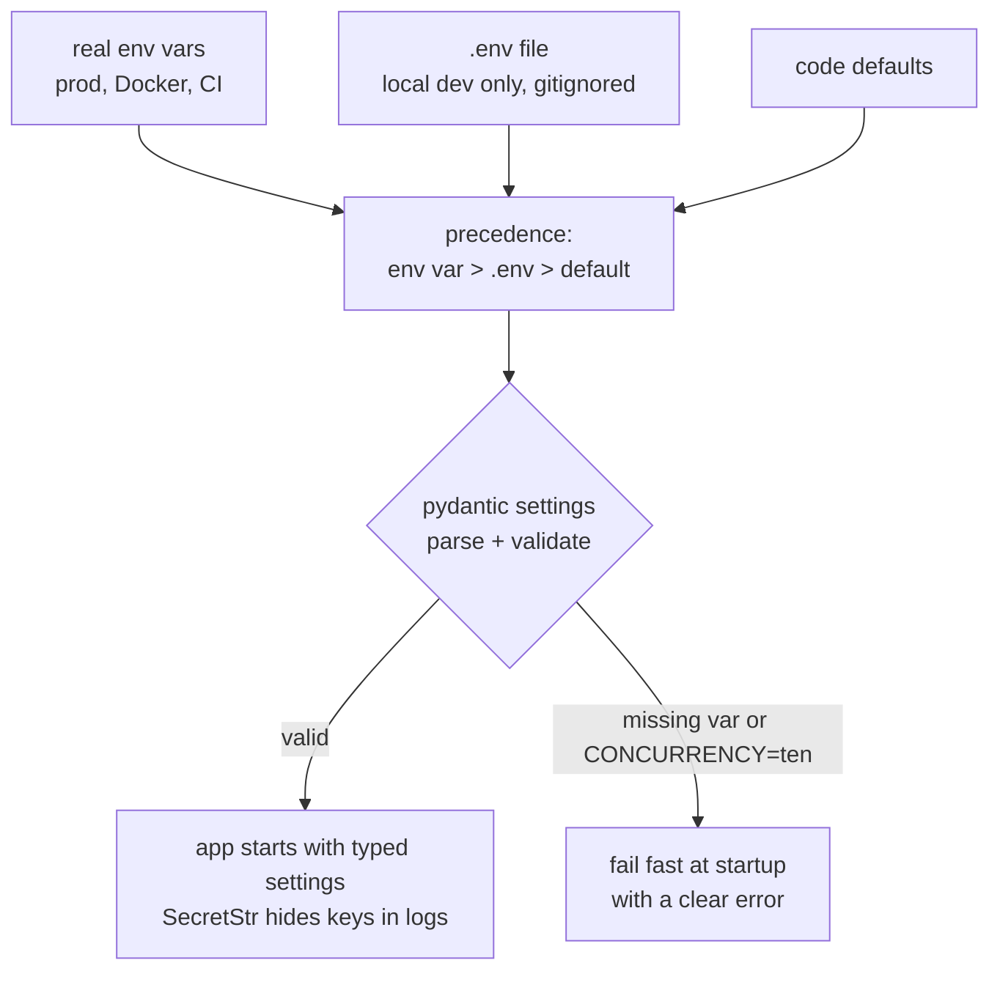

# Python & Linux Foundations

## Environment variable configurations

> **Core** | ~1.2 h | Slow: step 027/256, CP1 | Fast: CP1
>
> Before this: [M01-04 Exception handling](<04 - Exception handling.md>), [M01-14 Shell scripting basics](<14 - Shell scripting basics.md>)

### Kahani
Ek SaaS customer ke staging pe aapka RAG service perfect chala. Production deploy ke baad pehle hi ghante mein LLM bill 6x.
Pata chala: `config.py` mein `MODEL = "big-model"` hardcoded tha, staging ke liye kisi ne local edit kiya tha aur wo commit nahi hua; prod pe default chal gaya.
Usi file mein ek purana API key bhi commit tha -- security team ne poora repo history scan karwaya.
Aur `CONCURRENCY="ten"` jaisi typo pe service start ho gayi, phir pehli request pe crash hui.
Config ka ek rule hai: code har jagah same, environment alag -- aur galat config pe service start hi na ho.

### What it is
**Environment variables** process ke saath aane wale key=value strings hain (`os.environ`). **12-factor app** kehta hai: config (URLs, keys, limits, feature flags) env se aaye, code se nahi.
`.env` file sirf local dev ke liye ek convenience hai jo env vars set karti hai -- ye git mein kabhi nahi jaati. Startup pe sab vars ko ek typed, validated settings object mein parse karo (yahan pydantic `BaseModel`), taaki galat value pe turant fail ho.

### Why it matters for an FDE
Har customer ka environment alag hai (unka LLM gateway URL, unka DB, unke rate limits, unka region). Ek hi Docker image sab jagah chale, config env se aaye, aur secrets kabhi repo/logs mein na dikhe -- yahi enterprise security review pass karta hai.

### Key concepts
- **Sab kuch string hai** -- `os.environ["PORT"]` hamesha `str`; type conversion + validation aapki zimmedari (pydantic karega).
- **Fail fast** -- required var missing ya invalid ho to startup pe hi clear error, pehli request pe nahi.
- **Precedence** -- real env var > `.env` file > code default. `.env` loader kabhi already-set env var ko override na kare.
- **Secrets** -- `SecretStr` se repr/log mein `**********`; `.env` ko `.gitignore` mein, repo mein sirf `.env.example` (bina values).
- **Prefix** -- `APP_` jaisa prefix se apne vars alag rakho (`APP_LLM_API_KEY`), doosre tools ke vars se clash nahi.

### Picture it
Same code everywhere, config from the environment, and a bad value stops the service at startup, not at the first request.



### Code example
`pip install pydantic`  (pydantic v2; no pydantic-settings needed)

```python
# runnable
import os
import tempfile
from pathlib import Path

from pydantic import BaseModel, Field, HttpUrl, SecretStr, ValidationError


def load_dotenv(path: Path, environ=os.environ) -> None:
    """Tiny .env loader: KEY=VALUE, # comments, optional quotes. Never overrides real env vars."""
    if not path.exists():
        return
    for raw in path.read_text().splitlines():
        line = raw.strip()
        if not line or line.startswith("#") or "=" not in line:
            continue
        key, value = line.split("=", 1)
        key, value = key.removeprefix("export ").strip(), value.strip()
        if len(value) >= 2 and value[0] == value[-1] and value[0] in "\"'":
            value = value[1:-1]
        environ.setdefault(key, value)              # real env wins over .env


class Settings(BaseModel):
    llm_base_url: HttpUrl
    llm_api_key: SecretStr
    llm_model: str = "small-model"
    concurrency: int = Field(5, ge=1, le=50)
    request_timeout_s: float = Field(30.0, gt=0)
    debug: bool = False

    @classmethod
    def from_env(cls, environ=os.environ, prefix="APP_") -> "Settings":
        data = {k[len(prefix):].lower(): v for k, v in environ.items() if k.startswith(prefix)}
        return cls.model_validate(data)             # pydantic converts "10" -> 10, "true" -> True


tmp = Path(tempfile.mkdtemp())
(tmp / ".env").write_text(
    "# local dev only -- this file is in .gitignore\n"
    "APP_LLM_BASE_URL=http://localhost:8080/v1\n"
    'APP_LLM_API_KEY="sk-local-dev-fake"\n'
    "export APP_CONCURRENCY=10\n"
    "APP_DEBUG=true\n"
)

env = {"APP_CONCURRENCY": "3", "PATH": "/usr/bin"}  # pretend this is the real process env
load_dotenv(tmp / ".env", env)
s = Settings.from_env(env)
print(s)
assert s.concurrency == 3, "real env var must beat .env"
assert s.debug is True and s.llm_model == "small-model"
assert "sk-local" not in repr(s) and "sk-local" not in str(s.model_dump())
assert s.llm_api_key.get_secret_value() == "sk-local-dev-fake"  # only where you call the API

bad_env = {"APP_LLM_BASE_URL": "not-a-url", "APP_CONCURRENCY": "ten"}
try:
    Settings.from_env(bad_env)
    raise AssertionError("should fail fast")
except ValidationError as err:
    fields = sorted(e["loc"][0] for e in err.errors())
    print("startup refused, bad fields:", fields)
    assert fields == ["concurrency", "llm_api_key", "llm_base_url"]

gitignore = "\n".join([".env", ".env.*", "!.env.example"])
assert ".env" in gitignore.splitlines()
print("OK: typed settings, env beats .env, secrets hidden, bad config fails at startup")
```

- `load_dotenv` -- `setdefault` ki wajah se real env (Docker/ECS/CI se aaya) hamesha jeetta hai; `.env` sirf laptop pe gaps bharta hai.
- `Settings` -- har field typed + bounded (`ge=1, le=50`). `CONCURRENCY="ten"` startup pe hi `ValidationError`, ek saath saare bad fields ke saath.
- `SecretStr` -- `print(s)` aur `model_dump()` mein key masked; `get_secret_value()` sirf us jagah jahan actual API call hoti hai.
- `from_env` prefix strip karke lowercase karta hai -- ye pydantic-settings jaisa behaviour ~10 lines mein hai. Bade project mein `pydantic-settings` use kar sakte ho (check the docs for your version).
- Example `.gitignore` -- `.env` ignore, `.env.example` commit (sirf keys, values khaali).

Shell side:

```bash
cp .env.example .env                       # then fill values locally, never commit
APP_CONCURRENCY=2 python worker.py          # one-off override for a single run
export APP_DEBUG=false                      # for the rest of this shell session
env | grep '^APP_' | sed 's/=.*/=<set>/'    # check what is set without printing secrets
git ls-files | grep -E '(^|/)\.env$' && echo "DANGER: .env is tracked"
```

### Mini-exercise (30-60 min)
CP1 capstone worker (`fde-exercises/m01_async_worker/`) ko config-driven banao:
- `settings.py` with `Settings.from_env()` -- `CONCURRENCY`, `DB_WORKERS`, `LLM_TIMEOUT_S`, `LLM_BASE_URL`, `LLM_API_KEY` (SecretStr), `LOG_LEVEL` (Literal).
- `.env.example` commit karo, `.env` ko `.gitignore` mein; `main()` startup pe settings load kare aur masked summary log kare.
- Ek pre-commit style check script (`scripts/check_no_secrets.sh` ya Python) jo staged files mein `sk-` / `AKIA` jaise patterns dhoonde aur mile to exit 1.
- Acceptance: pytest -- invalid env pe `ValidationError`, env > `.env` precedence, `repr(settings)` mein key nahi.

### Common pitfalls
- Secret ko `.env` mein daal ke galti se commit -- `.gitignore` pehle din banao. Commit ho gaya to sirf delete kaafi nahi: key rotate karo (history mein rehta hai).
- Settings object ya poora `os.environ` log/print karna, ya exception mein env dump karna -- secrets logs aur error trackers mein chale jaate hain.
- Har jagah `os.getenv("X", "default")` bikhra hua -- defaults alag-alag files mein, koi validation nahi. Ek `Settings` class, startup pe ek baar, phir dependency ki tarah pass karo.

### Checklist before moving on
- [ ] Main 12-factor config principle ek line mein bata sakta hoon.
- [ ] Mera service galat/missing config pe startup pe hi fail hota hai.
- [ ] Secrets `SecretStr` mein hain aur logs mein masked dikhte hain.
- [ ] `.env` gitignored hai, `.env.example` committed hai.

### Related
- [M01-14](<14 - Shell scripting basics.md>) Shell scripting basics
- [M02-02](<../02 - Modern API Development/02 - Pydantic data validation.md>) Pydantic data validation
- [M04-11](<../04 - Containerization & CI-CD/11 - Managing GitHub secrets.md>) Managing GitHub secrets
- [M14-03](<../14 - AI Observability & Gateway Management/03 - Centralizing provider API keys via LiteLLM and Portkey.md>) Centralizing provider API keys via LiteLLM and Portkey

### Self-quiz
1. Docker container mein `APP_CONCURRENCY=8` set hai aur image ke andar `.env` mein `APP_CONCURRENCY=2`. Kaunsa value chalega aur kyun ye sahi design hai?
2. "Fail fast on config" ka production mein kya faayda hai? Ek counter-example do jahan lazy failure nuksaan karti hai.
3. Ek API key galti se public repo mein push ho gayi aur aapne next commit mein hata di. Kya ab safe hai? Kya karoge?
4. Secrets ke liye env vars ki kya limitations hain (e.g. `ps`, crash dumps, child processes), aur bade customers kya use karte hain?

<!-- nav: generated by portal/lessonnav.py, do not edit below -->

---

**Slow track, step 027 of 256** -- [Syllabus CP1](<../SYLLABUS.md#cp1>) | [START_HERE](<../START_HERE.md>)

- <- Prev: [step 026: Shell scripting basics](<14 - Shell scripting basics.md>)
- Next -> step 028 BUILD: fde-exercises monorepo + one async worker exercise (asyncio + ThreadPoolExecutor) -- see [syllabus](<../SYLLABUS.md#cp1>)
- then lesson: [step 030: Path and query parameters](<../02 - Modern API Development/01 - Path and query parameters.md>)
