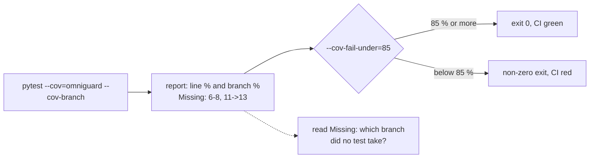

# Modern API Development

## Test coverage analysis

> **Core** | ~1.2 h | Slow: step 042/256, CP2 | Fast: CP2
>
> Before this: [M02-11 Unit testing fundamentals](<11 - Unit testing fundamentals.md>), [M02-12 Fixtures and mocking](<12 - Fixtures and mocking.md>)

### Kahani
Ek bank ka security team aapki document API ko production mein aane se pehle review kar raha hai.
Aapne kaha "humare paas 40 tests hain." CISO ka sawaal: "Access-control code ka kitna hissa tests ne actually chalaya? Confidential + no-MFA wala path test hua?"
Aapke paas jawab nahi tha. Baad mein pata chala `can_read()` ka "deny" branch kabhi kisi test ne chalaya hi nahi -- aur usi mein bug tha jo interns ko confidential docs dikha deta.
Aapko chahiye ek report jo line-by-line bataye kya test hua, kya nahi -- aur CI mein ek gate jo coverage girne pe build rok de.

### What it is
**Code coverage** = test run ke dauran aapke code ki kaunsi lines (aur branches) execute hui, uska measurement. Python mein `coverage.py`, pytest ke saath `pytest-cov` plugin.
**Line coverage** = kaunsi lines chali. **Branch coverage** = har `if` ke dono raaste (true/false) chale ya nahi. Jest ka `--coverage` (istanbul) jaisa hi -- wahan bhi "Branch %" column hota hai.

### Why it matters for an FDE
Customer ke security/QA reviewers number aur evidence maangte hain. Coverage report dikhati hai kahan test nahi hain -- khaas kar auth, validation aur PII paths mein -- aur CP2 gate ka proof yahi report hai.

### Key concepts
- **`--cov=<package>`** -- sirf apna code measure karo (`--cov=omniguard`), tests ya libraries nahi.
- **`--cov-report=term-missing`** -- table mein `Missing` column: missed line numbers (`6-8`) aur partial branches (`11->13` = line 11 se 13 pe kabhi jump nahi hua).
- **`--cov-branch`** -- branch coverage on. Bina iske `if` jiska sirf true path chala wo bhi "100% lines" dikhta hai.
- **`--cov-fail-under=N`** -- coverage N% se kam to pytest non-zero exit code -> CI fail. Ye "gate" hai.
- **Coverage != correctness** -- 100% ka matlab sirf "har line chali", ye nahi ki asserts sahi hain. Low coverage pakka problem hai; high coverage guarantee nahi.

### Picture it
Coverage shows which lines and branches ran; the fail-under number turns it into a CI gate.



### Code example
`pip install pytest pytest-cov`

```python
# runnable
import subprocess
import sys
import tempfile
from pathlib import Path

POLICY = '''\
def can_read(role: str, classification: str, mfa: bool = False) -> bool:
    if role == "admin":
        return True
    if classification == "public":
        return True
    if classification == "confidential" and not mfa:
        return False
    return role in {"analyst", "doctor"}

def redact(text: str, role: str) -> str:
    if role != "admin":
        text = text.replace("SSN", "[REDACTED]")
    return text
'''

TESTS_V1 = '''\
from policy import can_read, redact

def test_admin_reads_everything():
    assert can_read("admin", "confidential")

def test_public_is_open():
    assert can_read("intern", "public")

def test_analyst_sees_redacted_ssn():
    assert redact("SSN 123", "analyst") == "[REDACTED] 123"
'''

TESTS_V2 = '''\
from policy import can_read, redact

def test_confidential_needs_mfa():
    assert not can_read("doctor", "confidential", mfa=False)
    assert can_read("doctor", "confidential", mfa=True)

def test_intern_cannot_read_internal():
    assert not can_read("intern", "internal")

def test_admin_text_untouched():
    assert redact("SSN 123", "admin") == "SSN 123"
'''


def run_cov(d: Path):
    cmd = [sys.executable, "-m", "pytest", "-q", "-p", "no:cacheprovider",
           "--cov=policy", "--cov-branch", "--cov-report=term-missing", "--cov-fail-under=100"]
    r = subprocess.run(cmd, cwd=d, capture_output=True, text=True, timeout=60)
    row = next(line for line in r.stdout.splitlines() if line.startswith("policy.py"))
    return r, row


with tempfile.TemporaryDirectory() as tmp:
    d = Path(tmp)
    (d / "pytest.ini").write_text("[pytest]\n")
    (d / "policy.py").write_text(POLICY)
    (d / "test_v1.py").write_text(TESTS_V1)

    r1, row1 = run_cov(d)
    print("before:", row1)          # columns: Stmts Miss Branch BrPart Cover Missing
    assert r1.returncode != 0, "gate must fail below 100%"
    assert "Required test coverage of 100% not reached" in r1.stdout
    assert "6-8" in row1                       # lines never executed
    assert "11->13" in row1                    # line 11 never jumped to 13 (admin path)

    (d / "test_v2.py").write_text(TESTS_V2)
    r2, row2 = run_cov(d)
    print("after: ", row2)
    assert r2.returncode == 0, r2.stdout + r2.stderr
    assert "100%" in row2
print("OK: term-missing shows lines + partial branches, fail-under gates the build")
```

- `run_cov` -- wahi command jo aap CI mein chalaoge: `pytest --cov=policy --cov-branch --cov-report=term-missing --cov-fail-under=100`.
- Pehla run `65%` aur returncode non-zero -- `6-8` batata hai confidential/deny logic kabhi nahi chala. Kahani wala bug yahin chhupa tha.
- `11->13` -- `redact()` ki saari lines chali (line coverage 100%), lekin `role == "admin"` wala raasta kabhi nahi. Ye sirf `--cov-branch` se dikhta hai.
- `Cover` column branches bhi count karta hai: (statements + branches covered) / (statements + branches) -- isliye 3 missed lines ke baad bhi 75% nahi, 65% aaya.
- `test_v2.py` mein exactly missing paths ke tests -> 100% aur exit code 0. Workflow yahi hai: report padho, missing behaviour ke liye test likho, "lines ke liye" nahi.

Config ek jagah rakho (`pyproject.toml`) taaki local aur CI same chale:

```toml
[tool.pytest.ini_options]
addopts = "-q --cov=omniguard --cov-branch --cov-report=term-missing --cov-report=html --cov-fail-under=85"

[tool.coverage.run]
omit = ["omniguard/__main__.py"]

[tool.coverage.report]
exclude_also = ["if __name__ == .__main__.:", "raise NotImplementedError"]
```

### Mini-exercise (30-60 min)
CP2 capstone gate: "OmniGuard: FastAPI skeleton, Pydantic models, DI, pytest + coverage".
- `pyproject.toml` (omniguard repo root) mein upar wala config, `--cov=omniguard`, `--cov-fail-under=85`.
- `pytest` chalao, `term-missing` padho, aur `htmlcov/index.html` browser mein kholo -- laal lines dekho.
- Sabse pehle `omniguard/deps.py` (auth stub: missing header, bad token, wrong tenant) aur `omniguard/schemas.py` validators ke missing branches cover karo; phir CRUD ke 404/409/412 paths.
- Ek jagah jaan-boojh ke test hata ke dekho ki gate fail hota hai (exit code != 0), phir wapas lagao.
- Acceptance (gate proof): `pytest` output ka coverage table screenshot/text `docs/cp2-coverage.txt` mein save karo -- total >= 85%, `app/deps.py` 100% branch coverage, aur ek line README mein: "kaunse paths jaan-boojh ke uncovered hain aur kyun".

### Common pitfalls
- Coverage number ke liye assert-less tests likhna (`client.get("/x")` bina check) -- number badhta hai, safety nahi. Review mein dekho har test kuch assert karta hai.
- `--cov` bina package naam ke ya tests folder ko include karke measure karna -- number fake-high dikhta hai. `--cov=omniguard` explicit rakho.
- 100% ko target banana aur `# pragma: no cover` har jagah chhidakna -- gate realistic rakho (80-90%), lekin security-critical modules (auth, redaction) pe stricter.

### Checklist before moving on
- [ ] `term-missing` ka `6-8` aur `11->13` dono ka matlab bata sakta hoon.
- [ ] Line aur branch coverage ka fark ek example se samjha sakta hoon.
- [ ] Mera `pyproject.toml` coverage config aur `--cov-fail-under` gate rakhta hai.
- [ ] `omniguard` ka coverage report CP2 gate ke liye save kiya.

### Related
- [M02-11](<11 - Unit testing fundamentals.md>) Unit testing fundamentals
- [M02-12](<12 - Fixtures and mocking.md>) Fixtures and mocking
- [M02-14](<14 - Debugging configurations.md>) Debugging configurations
- [M04-09](<../04 - Containerization & CI-CD/09 - Creating workflow YAML files.md>) Creating workflow YAML files
- [M15-05](<../15 - OmniGuard - Secure AI Integration/05 - Delivering User Acceptance Testing (UAT) runbooks.md>) Delivering User Acceptance Testing (UAT) runbooks

### Self-quiz
1. Ek function ki line coverage 100% hai lekin branch coverage 50%. Ye kaise possible hai? Code example do.
2. Team bolti hai "coverage 95% hai, to bugs nahi honge." Is statement mein kya galat hai?
3. `--cov-fail-under` ka number kaise choose karoge ek purane customer codebase mein jahan abhi coverage 30% hai?
4. Kaunse code ko coverage se exclude karna theek hai aur kaunse ko kabhi nahi?

<!-- nav: generated by portal/lessonnav.py, do not edit below -->

---

**Slow track, step 042 of 256** -- [Syllabus CP2](<../SYLLABUS.md#cp2>) | [START_HERE](<../START_HERE.md>)

- <- Prev: [step 041: Fixtures and mocking](<12 - Fixtures and mocking.md>)
- Next -> [step 043: Debugging configurations](<14 - Debugging configurations.md>)
